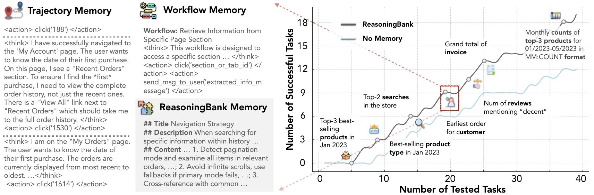
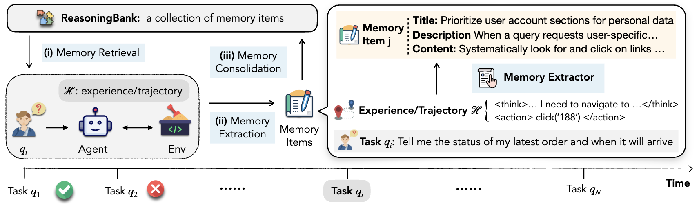

> **本仓库是对上游代码的复现实验（非官方实现）。**
>
> 上游把策略模型、裁判模型与检索向量全部绑定在 Gemini / Vertex AI 上。本仓库在不改动算法逻辑的前提下做了三件事：
>
> - 将策略、裁判、记忆提炼迁移到任意 OpenAI 兼容接口（实测 DeepSeek-chat）
> - 将检索向量迁移到本地 bge-m3（sentence-transformers，完全离线）
> - 修复了检索实现中「当前任务检索到自己」导致记忆注入恒为空的缺陷
>
> | 文档 | 内容 |
> | --- | --- |
> | [REPRODUCE.md](REPRODUCE.md) | 环境搭建与复现步骤、已知坑清单 |
> | [REPORT_复现报告.md](REPORT_复现报告.md) | 三轮实验、注入审计、29 项问题与解决方案 |
> | [report/report_assets/](report/report_assets/) | 实验结果图表 |
>
> **结果摘要**：shopping 站点 20 个任务双组对照，成功率 50% vs 50%（10/20），平均步数 6.4 → 8.2（+28%），
> 记忆注入率 20/20。结论：机制可复现，该规模下未观察到成功率收益。
>
> 基于上游 Apache-2.0 代码修改，保留原 [LICENSE](LICENSE)。
> # ReasoningBank: Scaling Agent Self-Evolving with Reasoning Memory

## 📜 Overview

<p align="center">
    
</p>

We introduce ReasoningBank, a memory mechanism for agents that learns from both 
successful and failed trajectories, with reasoning stored as memory content.

<p align="center">
    
</p>

Building upon this memory formulation, we propose memory-aware test-time scaling,
which leverages the bidirectional synergy between memory and test-time scaling,
establishing experience-driven memory as another scaling dimension for agent
systems.


## 📂 Code Setup
We release code for `SWE-Bench` (software engineering) and `WebArena` (web-browsing),
as in corresponding directories.

Before we start, please install required packages by running `pip install -r requirements.txt`.

### 0. LLM Configuration
Currently we support three model families: 
- **GPT**: To use GPT models (`gpt-3.5-turbo`, `gpt-4`, `gpt-4o`), you need to set your OpenAI API key as an environment variable:
  ```bash
  export OPENAI_API_KEY="your-openai-api-key"
  ```

- **Gemini & Claude**: To use Gemini models (`gemini-2.5-flash`, `gemini-2.5-pro`) or Claude (`claude-3-7-sonnet@20250219`) on Vertex AI, you need to configure Google Cloud authentication.
  1.  Install the Google Cloud CLI and log in to set up Application Default Credentials (ADC):
      ```bash
      gcloud auth application-default login
      ```
  2.  Set your project and location as environment variables, as they are required by clients like the one for Claude on Vertex AI:
      ```bash
      export GOOGLE_CLOUD_PROJECT="your-project-id"
      export GOOGLE_CLOUD_LOCATION="your-region"
      export GOOGLE_GENAI_USE_VERTEXAI="True"
      ```


### 1. WebArena
#### Docker Configuration
Make sure to correctly install `browsergym` following the [official documentation](https://github.com/ServiceNow/BrowserGym).

The next step is to download and config docker environment for WebArena. Please refer to [this tutorial](https://github.com/gasse/webarena-setup/tree/main/webarena),
executing the scripts follow the numerical order of file names. Before executing,
make sure to config the address of each website in corresponding scripts as
instructed correspondingly.

#### Directory Structure

* `WebArena/agents/`: implementation for web agents integrating with browsergym
* `WebArena/autoeval/`: llm-as-a-judge for obtaining correctness signal for trajectories
* `WebArena/config_files/`: data processing for webarena tasks
* `WebArena/prompt/`: instructions used across the implementation

#### Data preprocessing

Download raw test files from [here](https://github.com/web-arena-x/webarena/blob/main/config_files/test.raw.json) and put it to `config_files`. The repo also vendors a patched copy at `third_party/webarena/test.raw.json` with shopping-split annotation corrections; use either one.

Run `generate_config_files.py` to process raw test data to config files as input.

#### Use the vendored `webarena` tree

The repo ships a patched `webarena/` harness at `third_party/webarena/` (corrected shopping annotations, wishlist eval fix, `fill('','')` guard, `retry_with_force=True` clicks) to make environment and corresponding evaluation more robust and stable. Prepend it to `PYTHONPATH` so it shadows the pip-installed `browsergym.webarena`:

```bash
export PYTHONPATH="$(pwd)/third_party:$PYTHONPATH"
```

`webarena` is a namespace package, so no code edits are required — every `webarena.*` submodule resolves to the vendored copy.


#### Run the code

Run directly with ReasoningBank: `bash run.sh`, config `model`, `output_dir`, and
`website`, and `memory_mode` accordingly.

To run with scaling setting, please refer to
`pipeline_scaling.py` and `induce_scaling.py`.

### 2. SWE-Bench
We built upon [mini-swe-agent](https://github.com/SWE-agent/mini-swe-agent). First, install it from source by `pip install -e .` under the directory of `./third_party` This will install the dependencies as specified in `pyproject.toml`.

The script `SWE-Bench/run.sh` provides direct running command, which will generate
result files in the output directory. Before running, make sure the
configuration for VertexAI is properly configured as instructed in `run.sh`.

For evaluation, please refer to `sb-cli` command in the [official documentation](https://mini-swe-agent.com/latest/usage/swebench/). 

## Acknowledgement
We adopt code from the following code repositories. We sincerely appreciate these
great work/codebases:

- [Agent-workflow-memory](https://github.com/zorazrw/agent-workflow-memory)
- [webarena](https://github.com/web-arena-x/webarena)
- [mini-swe-agent](https://github.com/SWE-agent/mini-swe-agent)

## 📚 Citation
If you find this work useful, please kindly cite our paper:
```
@inproceedings{
  ouyang2026reasoningbank,
  title={ReasoningBank: Scaling Agent Self-Evolving with Reasoning Memory},
  author={Siru Ouyang and Jun Yan and I-Hung Hsu and Yanfei Chen and Ke Jiang and Zifeng Wang and Rujun Han and Long Le and Samira Daruki and Xiangru Tang and Vishy Tirumalashetty and George Lee and Mahsan Rofouei and Hangfei Lin and Jiawei Han and Chen-Yu Lee and Tomas Pfister},
  booktitle={The Fourteenth International Conference on Learning Representations},
  year={2026},
  url={https://openreview.net/forum?id=jL7fwchScm}
}
```

## Disclaimer

This is not an officially supported Google product. This project is not
eligible for the [Google Open Source Software Vulnerability Rewards
Program](https://bughunters.google.com/open-source-security).

This project is intended for demonstration purposes only. It is not intended for use in a production environment.
